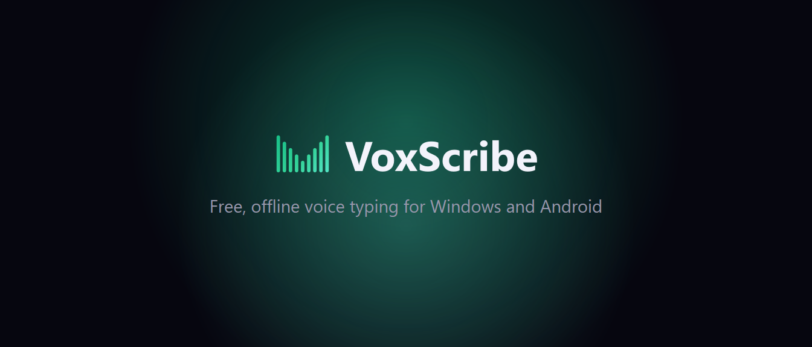
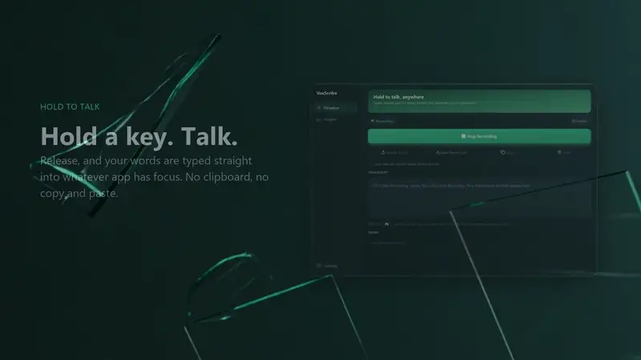
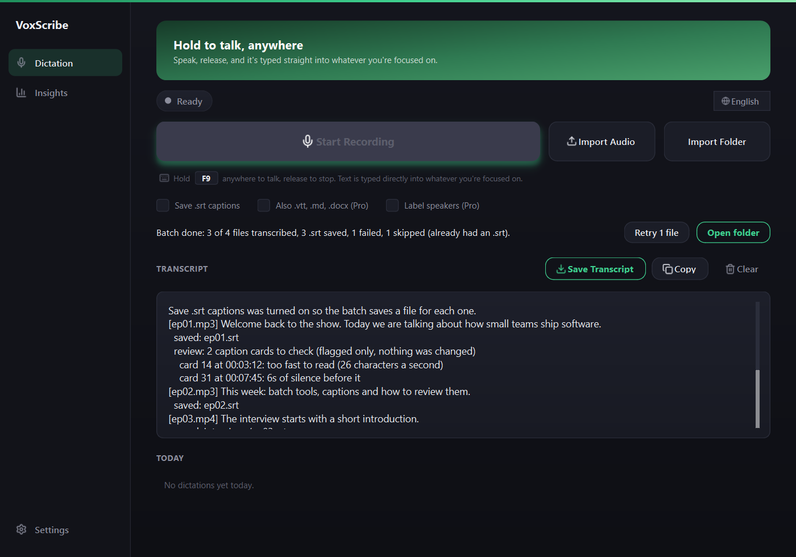
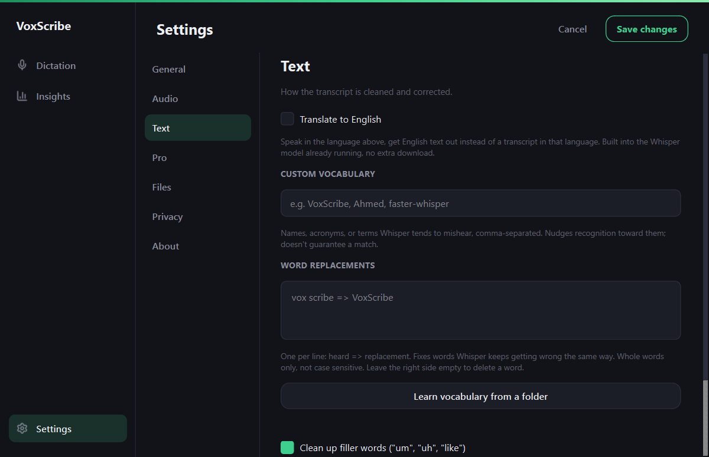
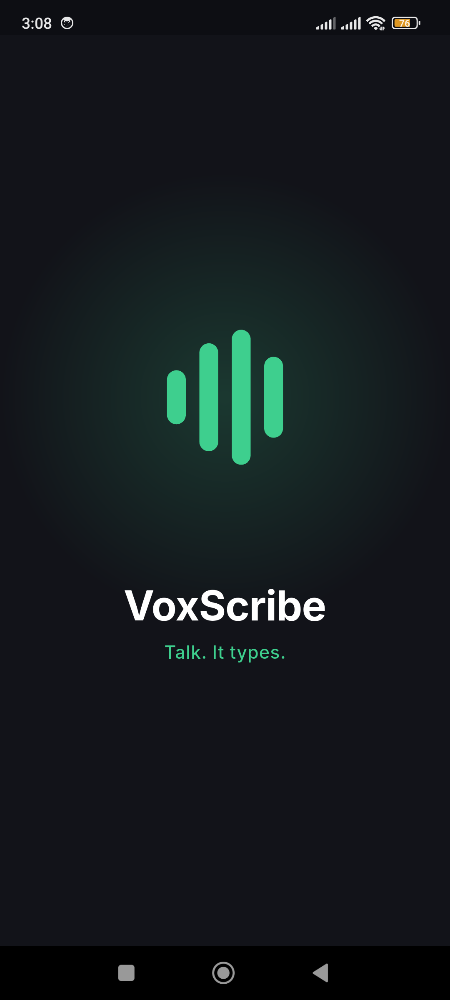
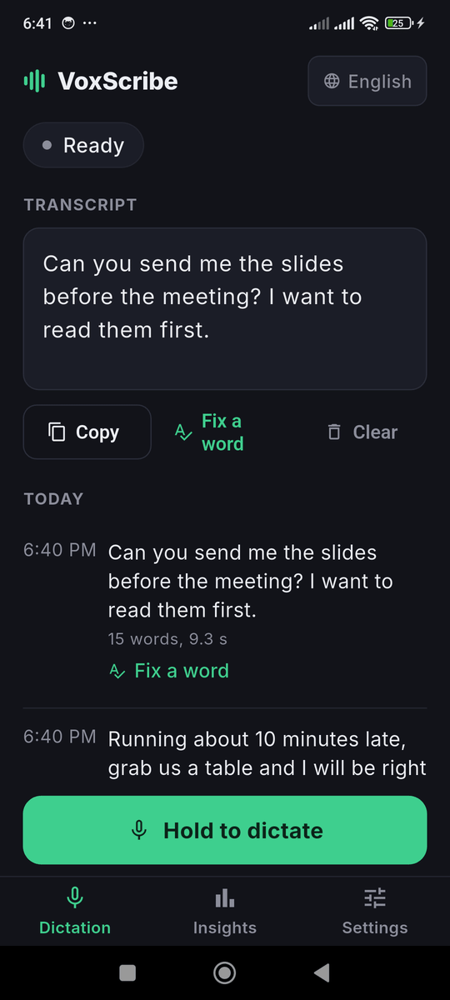
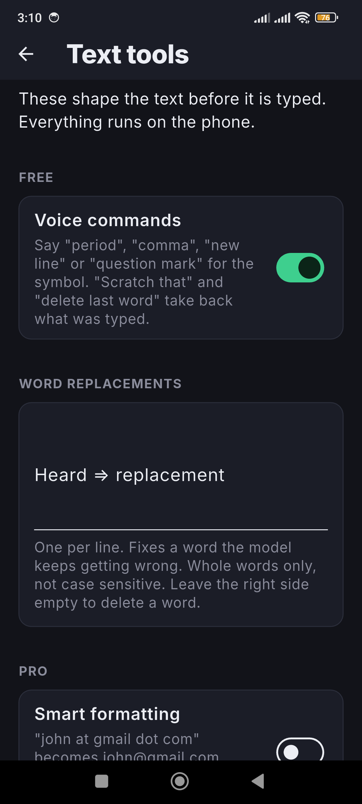

<p align="center">
  
</p>

<p align="center">
  <a href="https://github.com/ahmedhmam1994/voxscribe-ai-voice-dictation/actions/workflows/ci.yml"></a>
  <a href="https://github.com/ahmedhmam1994/voxscribe-ai-voice-dictation/releases/latest"></a>
  <a href="https://github.com/ahmedhmam1994/voxscribe-ai-voice-dictation/releases"></a>
  <a href="LICENSE"></a>
</p>

# VoxScribe

A free, open-source Windows desktop voice dictation app. Hold a global hotkey anywhere on your system, talk, release. Your speech is transcribed **locally on your PC** and typed directly into whatever window has focus.

Free and privacy-first: your voice audio is never uploaded anywhere.

<p align="center">
  <a href="https://github.com/ahmedhmam1994/voxscribe-ai-voice-dictation/raw/main/docs/assets/voxscribe-features.mp4">
    
  </a>
  <br>
  <sub>Click to watch the full 53 second feature overview.</sub>
  <br>
  <sub>Curious how it works? Read <a href="https://dev.to/ahmed_ibrahim_1994/what-broke-when-i-shipped-a-local-whisper-dictation-app-to-real-windows-hardware-11kg">what broke when I shipped it to real Windows hardware</a>.</sub>
</p>

## Screenshots

**Caption a whole folder in one run.** Drop in a folder of episodes and VoxScribe writes an .srt next to each file. It never overwrites an existing caption file, reports what it saved, skipped and failed, and flags cards that look too fast to read or follow a long silence. Failed files can be retried with one click.

<p align="center">
  
</p>

**Fix the words the model keeps getting wrong.** Add a short vocabulary list for names and jargon, and word replacements for anything it mishears the same way every time.

<p align="center">
  
</p>

## Features

- **Hold-to-talk hotkey (F9 by default, changeable):** works system-wide, in any app; change it from the tray menu's "Change Hotkey..."
- **Direct typing into the focused window:** not clipboard/paste, so it never overwrites what you've copied
- **100% local transcription:** powered by [faster-whisper](https://github.com/SYSTRAN/faster-whisper) running on your CPU; your audio never leaves your machine
- **Rule-based text cleanup:** strips filler words ("um", "uh", "like", "you know") without calling any paid AI API
- **Spoken commands:** say "period", "new line" or "question mark" for symbols, "scratch that" or "delete last word" to take back what you just typed, and "capitalize that", "all caps" or "replace X with Y" to change it. An optional "send it" presses Enter
- **Custom vocabulary and word replacements:** teach it names and jargon, and fix words it mishears the same way every time. Right-click a word in the transcript to always correct it, and export or import both lists as one file (the Android app reads it too)
- **Speech models by speed:** Fast, Balanced (the default) and, with Pro, three more accurate ones including Large turbo
- **Audio and video to captions:** import a file or a whole folder and get an .srt next to each one, capped at two short lines, timed from the word timestamps and cut at pauses. It never overwrites an existing caption file, and a report lists what was saved, skipped or failed, with a retry. Folder import has 2 free runs, then it is a Pro feature
- **Floating status indicator:** small pill shows Recording/Transcribing state
- **Runs from the system tray:** starts hidden, stays out of your way

## Download

Grab the latest installer from the [Releases page](https://github.com/ahmedhmam1994/voxscribe-ai-voice-dictation/releases).

Prefer a package manager? With winget, which ships with Windows 10 and 11:

```
winget install ahmedhmam1994.VoxScribe
```

Or with [Scoop](https://scoop.sh):

```
scoop bucket add voxscribe https://github.com/ahmedhmam1994/scoop-voxscribe
scoop install voxscribe
```

> **Note on Windows SmartScreen:** since VoxScribe is a new, unsigned app that hooks the keyboard (for the hotkey and to type text), Windows may show a "Windows protected your PC" warning on first run. Click **More info → Run anyway** to proceed. This is expected for unsigned indie software and not a sign of a problem.

The installer does not require admin rights (per-user install). On first launch, VoxScribe downloads the Whisper speech model (a few hundred MB) from Hugging Face. This requires an internet connection once; after that, transcription works fully offline.

## Android

VoxScribe also has an Android app. A small floating button appears above your keyboard whenever you tap a text box, in any app. Hold it, talk, release, and the text is typed into the box. It works with whichever keyboard your phone already uses, and your voice is transcribed on the phone, never uploaded.

**Install:** download `VoxScribe-Android-1.1.0.apk` from the [Android 1.1.0 release](https://github.com/ahmedhmam1994/voxscribe-ai-voice-dictation/releases/tag/android-v1.1.0) and open it. Android will ask you to allow installs from your browser or file manager. It is an APK only for now, not on the Play Store.

- Android 8 or newer, 64-bit phone (almost every phone from the last several years)
- The speech model is bundled in the app, so the download is about 115 MB and it works in airplane mode
- Setup takes three permissions, and the app walks you through them: microphone, the Accessibility service (Android requires it to let an app type into other apps), and display over other apps
- Tap the button to start and stop, or hold it. Drag it to the bottom of the screen to hide it for 10 minutes. It never appears in password or PIN boxes
- Email, web address and number boxes get the text the way they expect, for example "sam at gmail dot com" becomes sam@gmail.com
- Spoken commands ("period", "new line", "scratch that", "capitalize that", "replace X with Y"), an optional "send it" that taps the Send button, "Fix a word", and word replacements with export and import are free, each with its own page in Settings. Smart formatting, code dictation, fill-in templates and per-app profiles unlock with the same Pro key as Windows, which also unlocks Snippets
- When a newer Android release is published, the app shows an update banner with a download button

<p align="center">
  
  
  
</p>

The Android source is in [`android/voxscribe_app`](android/voxscribe_app): Flutter for the app screens, Kotlin for the floating button, typing service and speech engine.

## Requirements

- Windows 10 or 11
- A working microphone
- ~1GB free disk space (app + downloaded model)

## How it works

1. Hold **F9** (or your chosen hotkey, see the tray menu's "Change Hotkey...")
2. Speak
3. Release the hotkey. The transcribed, cleaned-up text is typed into whatever app you're focused in

## Privacy

- Audio is captured, transcribed, and discarded locally: your audio and text are never sent to a server
- Text cleanup is regex-based, running entirely on your machine: no AI API calls
- Network use is limited to: the one-time Whisper model download on first run, a check for new versions on GitHub, an anonymous usage ping (app version, OS version and a random id; on every launch on Windows, at most once a day on Android; can be turned off in Settings), and a one-time activation request if you buy Pro. See the [privacy policy](https://voxscribe-ai-voice-dictation.vercel.app/privacy.html) for details

## Building from source

```
python -m venv venv
venv\Scripts\pip install -r requirements.txt
venv\Scripts\python.exe main.py
```

See [CLAUDE.md](CLAUDE.md) for architecture notes and build/packaging commands (PyInstaller + Inno Setup).

## Command line

The same local engine can be called from scripts. From a source checkout:

```
venv\Scripts\python.exe cli.py meeting.mp3
venv\Scripts\python.exe cli.py talk.mp4 --format srt --output captions
venv\Scripts\python.exe cli.py interview.m4a --language auto --translate
```

Text goes to stdout, or into the `--output` folder (an existing file is never replaced). Plain text is cleaned and uses your word replacements, like dictation; `--raw` gives it exactly as heard. Plain text and `.srt` are free; `.vtt`, `.md` and the three most accurate models need Pro, as in the app. Run `cli.py --help` for every option.

## Code signing

The installer is currently unsigned, so Windows SmartScreen shows an "unknown publisher" warning on first run. VoxScribe is applying for a free certificate through the [SignPath Foundation](https://signpath.org)'s open-source program: see [CODE_SIGNING.md](CODE_SIGNING.md) for the policy that program requires. Paid alternatives also work: a traditional OV/EV certificate from a CA (SSL.com, Sectigo, roughly $70 to $400/yr), or [Microsoft Trusted Signing](https://learn.microsoft.com/en-us/azure/trusted-signing/) via Azure (usage-based, no hardware token required). With any of these, run `scripts\sign_release.ps1` after building; see that script's header comment for exact usage.

## License

[MIT](LICENSE)
